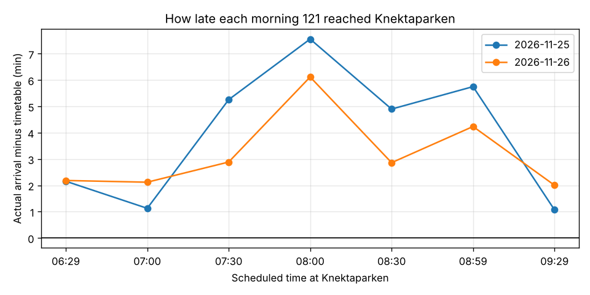
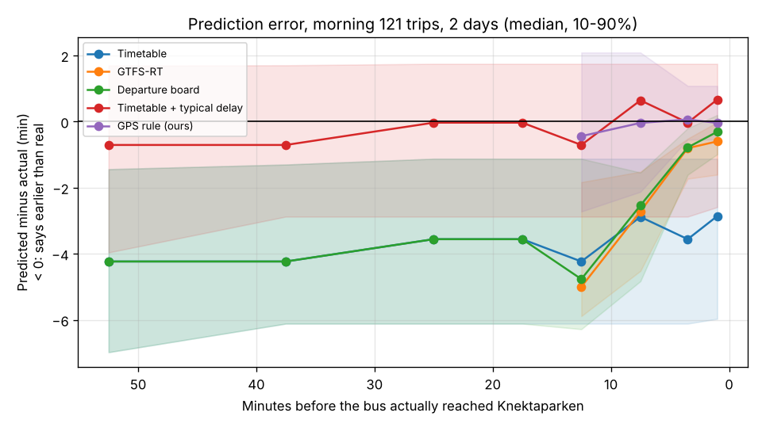
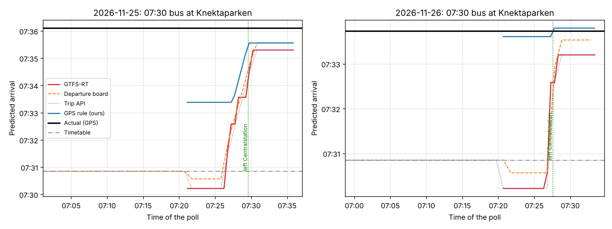

# Findings: when does the 07:30 bus 121 really reach Knektaparken?

**Preliminary: based on 2 weekday mornings (Wed 25 and Thu 26 Nov 2026).**
That is 2 runs of the 07:30 trip and 14 morning 121 trips in total. Treat
every number below as a first impression, not a statistic.

## The answer so far

- **The 07:30 bus was late both days**: it reached Knektaparken at
  **07:36:06** (5.3 min late) and **07:33:44** (2.9 min late). The timetable
  says 07:30:51.
- **No morning 121 was ever early.** Over all 14 trips the bus reached
  Knektaparken 1.1 to 7.6 min after the timetable (median 2.9 min).
- **Why it's late:** the bus is standing at Jönköping Centralstation from
  about 07:20, but leaves 2.6 to 4.6 min after its scheduled 07:25. It then
  needs about 6 min to reach Knektaparken, while the timetable allows 5.9 min.
  Almost all of the delay is the late start, not traffic.
- **JLT's predictions are just the timetable until the bus starts moving.**
  Until about 07:20 the departure board shows 07:30:51 with no real-time data.
  When the bus logs on to the trip (07:20) it shows 07:30:13 to 07:30:34,
  i.e. *earlier* than the timetable, while the bus is still parked. Only when
  the bus actually leaves Centralstation (07:27 to 07:30) does the time jump
  to roughly the right value.
- **JLT is always too early, never too late.** 10 to 15 min ahead it says the
  bus will come about 4 min before it really does. In the last 5 min it is
  0.5 to 1 min early. So trusting JLT's app has not made you miss the bus; it
  has made you wait.

### Practical recommendation (for now)

1. **Simple rule:** be at Knektaparken by **07:31**. It caught the bus on 14
   of 14 morning trips. Expected wait for the 07:30 bus: about 3 to 5 min.
2. **Better rule, with the app:** watch the 07:30 departure in JLT's app.
   When its time **jumps later** (between about 07:26 and 07:30), the bus is
   leaving Centralstation. Once it had left, it took **4.9 to 7.2 min**
   (median 6.1) to reach Knektaparken; on 25 Nov the jump came 2 to 3 min
   before the bus left, which only gives you more time. If your walk to the
   stop is 4 min or less, you can leave home when the time jumps, and you'd
   have waited about
   1 to 3 min.
3. Once the time has jumped, JLT's prediction is good: add about 1 minute to
   it.

Don't rely on any of these yet for a tight connection. Two days can't show
how bad a bad day gets (snow, an accident, a missed start).

## Data quality

| Check | Result |
|---|---|
| Days | 24 Nov 22:00 to 26 Nov 17:36. Full mornings: **25 and 26 Nov** only. |
| GPS (`vehicle_positions_121.csv`) | 6,086 unique fixes, 12 vehicles, 78 trips. During 06:30 to 10:00 one fix per bus every 28 to 33 s, no gaps on the 07:30 trip. |
| Target trip | trip_id `66100000082446005`, direction Gränna, Centralstation 07:25:00, Rådhusparken 07:26:36, Knektaparken 07:30:51. Same vehicle both days. |
| Stop | Knektaparken stop area 18000 (57.779287, 14.188212), platform A for the Gränna direction. The bus came within 14 to 15 m of these coordinates and stood still, so they match the platform. |
| JLT predictions | GTFS-RT rows for the 07:30 trip only from 07:20 (when the bus logs on); about 50 polls per morning. Departure board and Trip API every minute from 06:30. |
| After 10:00 | GPS drops to one fix per 5 min, so the 09:59 and 10:30 trips have no usable arrival. They are left out. |
| Not checked | `collect.log`, `stop_lookup.json`, the static zip and `raw/` weren't available here, so collector gaps and other lines haven't been looked at. The schedule was taken from the Trip API (`trips_121.jsonl`) instead of `stop_times.txt`. |

## How arrivals were measured

For each trip, the bus's GPS track was compared with Knektaparken's
coordinates. Arrival is when the bus first came within 40 m, linearly
interpolated between the two fixes around that moment (about ±15 s). Leaving
Centralstation is when the bus first got more than 100 m from it. 12 trips
had a fix within 40 m ("ok"). On 2 trips the bus passed between two fixes
(closest fix 90 to 100 m away), so their arrival is the closest fix, accurate
to about ±30 s. See `derived/actual_arrivals.csv`.



| Morning trip (Knektaparken) | 25 Nov | 26 Nov |
|---|---|---|
| 06:29:49 | +2.2 min | +2.2 min* |
| 07:00:10 | +1.1 min | +2.1 min |
| **07:30:51** | **+5.3 min** | **+2.9 min** |
| 08:00:31 | +7.6 min | +6.1 min |
| 08:30:10 | +4.9 min | +2.9 min |
| 08:59:49 | +5.8 min* | +4.2 min |
| 09:29:49 | +1.1 min | +2.0 min |

\* passed between fixes, ±30 s.

The 07:30 and 08:00 trips were the latest on both days. 08:00 was 6 to 8
min late, so if 07:30 is ever too late, that's not a fix.

## How accurate are JLT's predictions?

Error = predicted minus actual arrival, over every poll in the hour before the
bus arrived. Negative means JLT said the bus would come earlier than it did.
All 14 morning trips, 2 days:

| Minutes before arrival | Timetable | JLT GTFS-RT | JLT departure board | Timetable + typical delay | GPS rule (ours) |
|---|---|---|---|---|---|
| 0–2 | −3.3 (6.0) | −0.7 (1.6) | −0.4 (1.0) | −0.1 (2.6) | +0.1 (1.2) |
| 2–5 | −3.8 (6.1) | −1.0 (1.7) | −0.9 (1.6) | −0.6 (2.9) | +0.2 (1.2) |
| 5–10 | −3.8 (6.1) | −2.8 (4.5) | −2.8 (4.8) | −0.6 (2.9) | +0.2 (2.5) |
| 10–15 | −3.9 (6.1) | −4.3 (5.9) | −4.0 (6.3) | −0.7 (2.9) | −0.4 (2.7) |
| 15–30 | −3.8 (6.1) | no data | −3.8 (6.1) | −0.6 (2.9) | no data |
| 30–60 | −4.2 (7.0) | no data | −4.2 (7.0) | −1.0 (4.0) | no data |

Each cell: mean error in min (90th percentile of the absolute error).
Full table, including the 07:30 trip on its own: run the script.



What this shows:

- **More than 10 min ahead, JLT is the timetable.** The board shows real-time
  data on 0% of polls 15+ min ahead and 29% at 10 to 15 min. JLT's GTFS-RT
  feed has nothing for the trip until the bus logs on.
- **When it does go real-time, it starts wrong.** While the bus is parked at
  Centralstation, JLT assumes it will leave on time, and even shows it 20 to
  40 s ahead of the timetable. It doesn't correct until the bus moves. This
  is a "late update" failure, not a constant offset.
- **In the last 5 minutes JLT is fine**: within 1 to 1.7 min. The GTFS-RT
  feed was on the safe side (too early) on 93 to 99% of polls. The board was
  up to 15 s too late on some polls in the last 2 minutes.
- **Is JLT better than the timetable?** Only in the last ~8 minutes. Before
  that it's identical, because it *is* the timetable.



What each source said for the 07:30 bus:

| Clock | 25 Nov: board | 25 Nov: GPS rule | 26 Nov: board | 26 Nov: GPS rule |
|---|---|---|---|---|
| 07:00 | 07:30:51 | – | 07:30:51 | – |
| 07:20 | 07:30:51 | – | 07:30:51 | – |
| 07:25 | 07:30:34 | 07:33:22 | 07:30:34 | 07:33:36 |
| 07:28 | 07:32:56 | 07:33:38 | 07:32:55 | 07:33:47 |
| 07:30 | 07:34:50 | 07:35:33 | 07:33:32 | 07:33:47 |
| **Actual** | **07:36:06** | | **07:33:44** | |

## Simple alternatives tried

Both are evaluated leave-one-day-out: the "typical" values are learnt from the
other day only. With 2 days that's 2 folds, so this is a sanity check, not a
proper evaluation.

- **Timetable + typical delay** (+2.9 min, the median delay of the other
  day's morning trips): unbiased and within ±2.9 min 90% of the time, at any
  lead time. Better than JLT until about 8 min before arrival.
- **GPS rule**: while the bus is at Centralstation, predict
  `max(now, 07:25 + typical late start) + typical drive time`; once it has
  left, `time it left + typical drive time` (about 6 min). Available from
  when the bus logs on, about 13 min before it arrives. It's unbiased and
  within ±1.2 min (last 5 min) to ±2.7 min (10 to 15 min) 90% of the time.
  It beats JLT from 2 to 15 min ahead, by the most at 5 to 15 min, because
  it knows the bus is still parked. In the last 2 min the board is slightly
  better.

Being unbiased means these are too late about half the time, so for catching
the bus they need a safety margin (about 2 min). JLT's early bias is
accidentally safe.

The other ideas in `ANALYSIS.md` (earlier buses as traffic sensors,
regression) need many more days and weren't tried.

## Limitations

- **2 mornings.** Two samples of the 07:30 trip. "14 of 14 trips" mixes
  different times of morning, which share a road and a terminal but aren't the
  same trip. You can't get a 19-in-20 safety margin from this.
- Both days were ordinary late-November weekdays. No snow, school holiday,
  Monday or Friday yet.
- Arrival times are ±15 s (±30 s for the two flagged trips).
- The cause of the late start at Centralstation is a guess from the GPS
  (the bus stands still close to the stop). It could be boarding, a driver
  change or a layover.

## Next steps

1. **Keep the collector running for at least 2 to 3 more weeks** (15 to 20
   weekday mornings). Then re-run
   `uv run --group analysis analysis/analyze.py` and the margin for 19 days
   in 20 becomes meaningful.
2. Check `collect.log` and the static zip on the laptop (not available here)
   for gaps.
3. Extend the GPS window to 10:30, or drop the late trips: the 09:59 and
   10:30 trips currently lack arrivals.
4. If the "bus leaves Centralstation late" pattern holds, the useful product
   is a tiny notifier: *"the 07:30 just left Centralstation, it'll be at
   Knektaparken in about 6 min"*. That's easy to build from the GTFS-RT
   VehiclePositions feed alone.

## Reproduce

```sh
uv run --group analysis analysis/analyze.py data
```

Writes `derived/actual_arrivals.csv`, `derived/prediction_errors.csv` and the
figures, and prints all the tables above.
